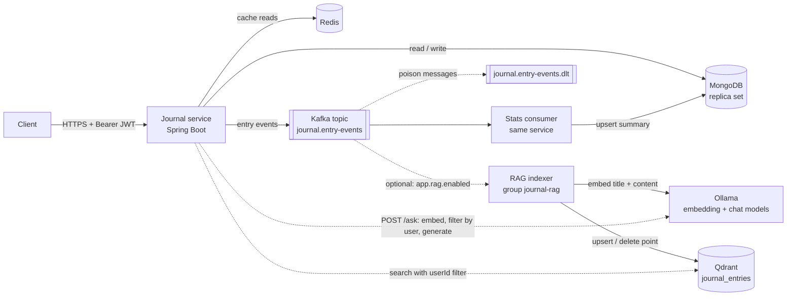

# Journal Service

A REST service for personal journals. Users register, log in and manage their own entries. The service
uses MongoDB for storage, Redis to cache reads, Kafka to publish entry events that a consumer turns into
a per-user activity summary, and stateless JWT authentication with Spring Security.

Stack: Java 17, Spring Boot 3.5, MongoDB 7, Redis 7, Apache Kafka (single-node KRaft), Maven.

## Architecture



Request path for an entry write: the controller validates the body, the service checks ownership, saves
to MongoDB, evicts the affected cache keys and publishes an event to Kafka. The consumer applies the event
to the `activity_stats` collection. `GET /api/v1/users/me/stats` reads that summary.

## Ask my journal (optional)

`POST /api/v1/ask` answers a question from the caller's own entries only (retrieval-augmented generation).
A second Kafka consumer group (`journal-rag`) embeds each created or updated entry and keeps one point per
entry in Qdrant; a question is embedded, searched with a mandatory `userId` filter, and the top entries are
given to a small local chat model through Ollama. It is off by default. Details and measured results:
[docs/RETRIEVAL.md](docs/RETRIEVAL.md).

```bash
APP_RAG_ENABLED=true docker compose --profile rag up -d   # adds ollama, qdrant and a one-shot model pull
```

The first start downloads the two models (about 1.7 GB). Without the profile and the variable, nothing changes.

## Run it

Requirements: Docker with Compose.

```bash
docker compose up -d --build     # app, mongo, redis, kafka; waits for health checks
docker compose ps                # all four services should report healthy
scripts/smoke.sh                 # end-to-end check against the running stack
docker compose down              # stop (add -v to also remove data volumes)
```

- API: `http://localhost:8080/api/v1`
- Swagger UI: `http://localhost:8080/swagger-ui.html`
- Health: `http://localhost:8080/actuator/health`, metrics: `http://localhost:8080/actuator/prometheus`

Copy `.env.example` to `.env` to override settings. The compose file contains a clearly labelled local
development value for `JWT_SECRET`; set your own for anything shared. To create a first administrator,
set `ADMIN_USERNAME` and `ADMIN_PASSWORD` before starting.

Run the tests (needs Docker, because the integration tests start MongoDB, Redis and Kafka with
Testcontainers):

```bash
./mvnw verify
```

Surefire runs the unit tests (`*Test`), Failsafe runs the integration tests (`*IT`). The JaCoCo report is
written to `target/site/jacoco/index.html`.

### Configuration

| Property / environment variable | Default | Meaning |
|---|---|---|
| `JWT_SECRET` | none, required | HMAC signing key, at least 32 characters |
| `MONGODB_URI` | `mongodb://localhost:27017/journal?replicaSet=rs0` | MongoDB connection |
| `REDIS_HOST`, `REDIS_PORT` | `localhost`, `6379` | Redis connection |
| `KAFKA_BOOTSTRAP_SERVERS` | `localhost:9092` | Kafka connection |
| `app.cache.enabled` / `APP_CACHE_ENABLED` | `true` | Turns the Redis cache on or off |
| `app.cache.entry-ttl`, `app.cache.page-ttl` | `10m`, `2m` | Time to live of cached entries and pages |
| `app.jwt.access-ttl`, `app.jwt.refresh-ttl` | `15m`, `7d` | Token lifetimes |
| `ADMIN_USERNAME`, `ADMIN_PASSWORD` | empty | Creates an initial administrator if both are set |
| `app.rag.enabled` / `APP_RAG_ENABLED` | `false` | Turns on indexing and `POST /ask` |
| `OLLAMA_URL`, `QDRANT_URL` | `http://localhost:11434`, `http://localhost:6333` | Model server and vector store |
| `RAG_CHAT_MODEL` | `llama3.2:1b` | Chat model name in Ollama (embeddings: `nomic-embed-text`) |

## Kubernetes (local kind cluster)

Manifests in `k8s/` and `scripts/k8s-up.sh` run the base stack (app x2, MongoDB, Redis, Kafka) on a local kind cluster and run the smoke test against it. Local demo only, not a production cluster. Details and recorded output: [docs/KUBERNETES.md](docs/KUBERNETES.md).

## Endpoints

All paths are under `/api/v1`. Everything except `/auth/*` requires `Authorization: Bearer <access token>`.

| Method | Path | Role | Description |
|---|---|---|---|
| POST | `/auth/register` | public | Create an account |
| POST | `/auth/login` | public | Exchange credentials for access and refresh tokens |
| POST | `/auth/refresh` | public | Exchange a refresh token for new tokens |
| POST | `/entries` | USER | Create an entry |
| GET | `/entries` | USER | List own entries. Parameters: `page`, `size` (max 100), `sort` (`date` or `title`), `q` (text search) |
| GET | `/entries/{id}` | USER | Read an own entry |
| PUT | `/entries/{id}` | USER | Update an own entry |
| DELETE | `/entries/{id}` | USER | Delete an own entry |
| GET | `/users/me` | USER | Read own profile |
| PUT | `/users/me` | USER | Update display name, optionally change password |
| DELETE | `/users/me` | USER | Delete the account with its entries and stats |
| GET | `/users/me/stats` | USER | Entry count, last entry date, current daily streak |
| POST | `/ask` | USER | Answer a question from own entries (needs `app.rag.enabled`). Body: `question`, optional `topK` (1 to 10, default 4). 503 when Ollama or Qdrant is down |
| POST | `/admin/rag/reindex` | ADMIN | Rebuild vector points from MongoDB; optional `userId` parameter limits it to one user |
| GET | `/admin/users` | ADMIN | List users (paged) |
| GET | `/admin/users/{id}` | ADMIN | Read a user |
| PUT | `/admin/users/{id}/admin` | ADMIN | Grant the admin role |
| DELETE | `/admin/users/{id}/admin` | ADMIN | Revoke the admin role |

Errors use one JSON shape: `timestamp`, `status`, `error`, `message`, `path` and a `violations` list of
`{field, message}` for validation failures. A request for another user's entry returns 404, so the
existence of the entry is not revealed.

## Design decisions

- **Stateless JWT with two token types.** The access token (15 minutes) authorizes API calls. The refresh
  token (7 days) is accepted only by `/auth/refresh`; a `typ` claim keeps them apart. Refresh reloads the
  user, so a deleted account cannot refresh and role changes apply to newly issued tokens. There is no
  token revocation list: a stolen access token stays valid until it expires.
- **Roles from the token, enforced with method security.** `AdminController` uses
  `@PreAuthorize("hasRole('ADMIN')")`. Passwords are hashed with BCrypt.
- **Ownership is part of every query.** Entries are read with `findByIdAndUserId`, so access control does
  not depend on remembering a separate check.
- **MongoDB indexes.** Unique index on `users.username`; compound index `{userId, date: -1}` for a user's
  entries newest first; a text index on title and content for the `q` parameter; a TTL index that removes
  processed-event markers after seven days.
- **Transaction for user deletion.** Deleting a user removes the user, their entries and their stats in
  one multi-document transaction, which is why compose runs MongoDB as a single-node replica set.
- **Cache-aside with Spring Cache on Redis.** Single entries (`entries`, key `userId:entryId`, 10 minute
  TTL) and entry pages (`entryPages`, 2 minute TTL) are cached as JSON. Updates and deletes evict the
  entry key. Any write clears all cached pages, which is simple and correct but coarse: one user's write
  empties every user's cached pages. If Redis is unreachable, cache errors are logged and requests fall
  back to MongoDB. `app.cache.enabled=false` swaps in a no-op cache manager.
- **Kafka events keyed by user id.** Events for one user land on one partition, so the consumer sees
  them in order, which the streak calculation needs. The consumer is idempotent: it inserts the event id
  into `processed_events` and updates the summary in one transaction, so a redelivered event is skipped.
  Failed records are retried twice, then sent to `journal.entry-events.dlt`; messages that cannot be
  deserialized go there directly.
- **Known limits.** Publishing to Kafka happens after the MongoDB write and is not atomic with it (no
  outbox), so an event can be lost if the process dies between the two. The streak is counted in UTC days
  and is not recomputed when an entry is deleted. Tokens of a deleted user remain valid until they expire.
- **Operations.** Actuator exposes health (with liveness and readiness probes) and Prometheus metrics.
  Logs are structured JSON (ECS format). The Docker image is built in two stages and runs as a
  non-root user.
